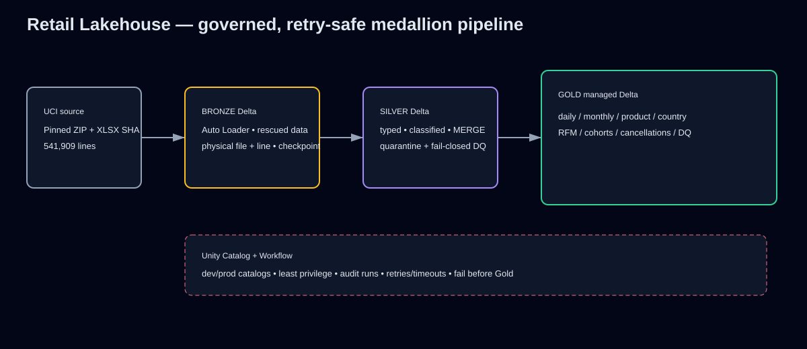

# Retail Lakehouse on Databricks

**Production-style Data Engineering portfolio | Databricks Asset Bundle + Delta medallion architecture | 541,909 UCI invoice lines | 100% row-accounted local reference run**

This project turns an immutable retail workbook into retry-safe Bronze/Silver/Gold contracts for merchandising, customer, cancellation, and data-quality decisions. It demonstrates the engineering a recruiter can inspect in ten seconds: Auto Loader, schema rescue, Delta MERGE, quarantine, Unity Catalog boundaries, Workflow dependencies, observability, and deterministic local proof.

> **Honest boundary:** Databricks assets are authored and statically tested. The full dataset was executed with the Local DuckDB reference pipeline. The bundle has **not been deployed or run in a live Databricks workspace**, and the grant template has not been applied, because no workspace credentials are available.

## Verified outcomes

| Contract | Local result |
|---|---:|
| Source / Bronze | 541,909 |
| Silver accepted / quarantine | 541,909 / 0 |
| Merchandise / non-merchandise / unknown-review | 537,378 / 3,045 / 1,486 |
| Cancellation lines | 9,288 |
| Cancellation mart (`StockCode` grain) | 1,936 |
| Gross / cancellation exposure / net merchandise value | £10,269,646.28 / £478,694.18 / £9,790,952.10 |
| Gold grains | 305 daily; 13 monthly; 3,819 products; 38 countries; 4,334 RFM customers; 91 cohort cells |

The explicit `cancellation_mart_rows=1936` result is verified local DuckDB/CSV evidence, not live Databricks evidence. These numbers are generated from `evidence/local_run_metrics.json`, not hand-estimated. December 2011 is explicitly labeled partial and excluded from completed-month comparisons.

## Architecture



`UCI ZIP/XLSX (pinned SHA-256) → external landing Volume → Auto Loader Bronze Delta → typed/quarantined Silver Delta → quality gate → Gold managed Delta marts`. Checkpoints and source identity make file ingestion retry-safe; `availableNow` correctly models a bounded file batch rather than fabricated CDC/real-time streaming.

## Run locally

```bash
uv sync --dev
uv run python scripts/acquire_data.py       # verifies exact ZIP/XLSX, then creates ignored pipeline-ready CSV
uv run python -m src.local_pipeline --source data/input/online_retail.csv
uv run pytest -q
```

The reference pipeline creates an ignored DuckDB database and deterministic evidence CSV/JSON. It fails on schema drift or unaccounted rows, quarantines invalid typed rows, scopes revenue to merchandise, computes RFM from purchase lines only, and records the observed source maximum as `source_max_epoch_seconds` plus the cancellation-mart row count as `cancellation_mart_rows`.

## Databricks deployment (not executed here)

```bash
databricks bundle validate -t dev
databricks bundle deploy -t dev
databricks bundle run retail_lakehouse_job -t dev
```

Review cloud-specific cluster settings and `sql/unity_catalog.sql` principals first. Dev/prod use separate catalogs. Landing is external; governed Bronze/Silver/Gold tables are managed. See the [runbook](docs/runbook.md), [data dictionary](docs/data_dictionary.md), [ADRs](docs/design_decisions.md), and [interview notes](docs/interview_talking_points.md).

## Evidence and quality

- `evidence/local_run_metrics.json` — local row reconciliation, selected Gold grains, cancellation-mart rows, and observed source maximum timestamp
- `evidence/acceptance_report.md` — exact executed checks and boundary
- `DEVELOPMENT_LOG.md` — observed RED/GREEN evidence
- `tests/` — classification, keys, acquisition safety, idempotency, row accounting, pure fail-closed DQ decisions, parsed Gold SQL semantics, workflow policy/graph, path/secret scan, and claim consistency
- `.github/workflows/ci.yml` — generated two-line fixture runs end to end in CI; full 541,909-row metrics are explicitly local evidence, not CI evidence

Source: UCI Online Retail, DOI [10.24432/C5BW33](https://doi.org/10.24432/C5BW33), CC BY 4.0. Raw inputs, local DuckDB state, virtual environments, and caches are excluded by `.gitignore` and omitted from the intended publication inventory. MIT-licensed project code.
